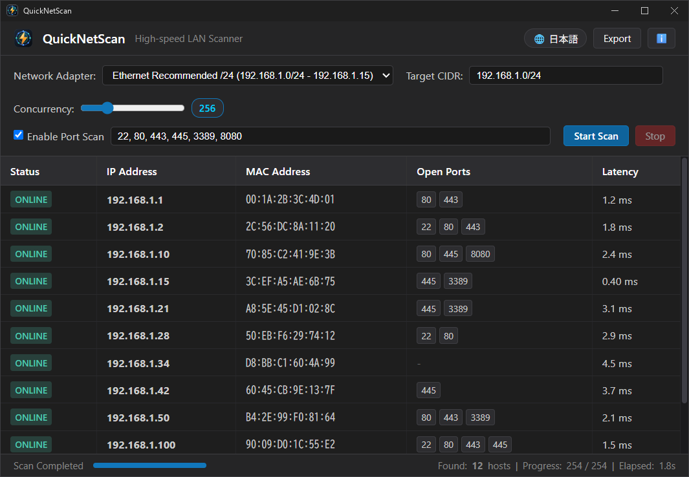

# QuickNetScan

<p align="center">
  
</p>

The application icon source files and `assets/maktak105-V04-01.jpg` creator badge are kept under `assets/`.
They are repository design assets and are not copied into the distribution ZIP.

QuickNetScan is a single-binary Windows utility that instantly scans local IP ranges (home or office LAN) using highly concurrent goroutines across hundreds of targets, listing active devices, IP/MAC addresses, open ports, and latency in real time.

## Using the binary release

If you do not need the source code or a build environment, download the distribution ZIP from GitHub Releases.

- [Latest releases](https://github.com/maktak-105/QuickNetScan/releases)
- [QuickNetScan v1.0.0](https://github.com/maktak-105/QuickNetScan/releases/tag/v1.0.0)
- [Direct download of QuickNetScan-binary.zip](https://github.com/maktak-105/QuickNetScan/releases/download/v1.0.0/QuickNetScan-binary.zip)

The ZIP contains all distribution files in one flat folder.

- `QuickNetScan.exe` - GUI version (self-contained single binary with embedded WASM UI)
- `QuickNetScan_cli.exe` - command-line version
- `readme.txt` / `readme_jp.txt` - distribution documentation
- `history.txt` / `history_jp.txt` - change log
- `LICENSE.txt` / `LICENSE_jp.txt` - MIT License files

### Integrity verification (SHA-256)

Official SHA-256 checksums for the distribution ZIP and binaries are automatically computed during the CI (GitHub Actions) build and published as `SHA256SUMS.txt` on each release page. Verify each downloaded release asset with PowerShell and compare its hash with the matching filename in `SHA256SUMS.txt`:

```powershell
Get-FileHash .\QuickNetScan-binary.zip -Algorithm SHA256
```

## Usage

### GUI Version

Double-click `QuickNetScan.exe`. The application opens a dark-themed UI.
1. Enter your target IP range (e.g. `192.168.1.0/24` or start/end IP).
2. Configure port scan presets (e.g. common web/file-sharing/SSH/RDP ports).
3. Click **Scan** to scan all hosts concurrently via goroutines.
4. Active hosts appear immediately with their IP, MAC address, vendor, open ports, and ping latency.

### CLI Version

```powershell
.\QuickNetScan_cli.exe -range 192.168.1.0/24 -ports 22,80,443,445,3389 -concurrency 256
```

## Building from source

### Prerequisites

- Go 1.22 or later
- Python 3.10+ (for helper scripts, optional)

### Build command

```powershell
.\scripts\build.bat
```

## License

This project is licensed under the MIT License. See [LICENSE](LICENSE) for details.
