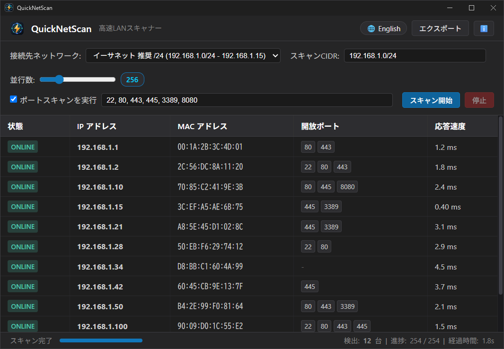

# QuickNetScan

<p align="center">
  
</p>

アイコンの原本や `assets/maktak105-V04-01.jpg`（作者ワッペン）は `assets/` に配置されています。
これらはリポジトリのデザイン用素材であり、配布用ZIPには含まれません。

QuickNetScan は、自宅LANや社内LANのIPレンジをGoの得意な並行処理（Goroutine）で数百スレッド同時に一瞬でスキャンし、生きている機器のIP・MACアドレス・空いているポート・応答速度を即座に一覧表示する単一EXEのWindowsユーティリティです。

## 配布版を使う

ソースコードやビルド環境が不要な場合は、GitHub Releases から配布ZIPをダウンロードしてください。

- [最新リリース一覧](https://github.com/maktak-105/QuickNetScan/releases)
- [QuickNetScan v1.0.0](https://github.com/maktak-105/QuickNetScan/releases/tag/v1.0.0)
- [QuickNetScan-binary.zip の直接ダウンロード](https://github.com/maktak-105/QuickNetScan/releases/download/v1.0.0/QuickNetScan-binary.zip)

ZIPにはすべての配布ファイルがフラットに同梱されています。

- `QuickNetScan.exe` - GUI版（WASM UIを内包した自己完結の単一EXE）
- `QuickNetScan_cli.exe` - コマンドライン版
- `readme.txt` / `readme_jp.txt` - 配布用説明書
- `history.txt` / `history_jp.txt` - 更新履歴
- `LICENSE.txt` / `LICENSE_jp.txt` - MITライセンス関連ファイル

### 完全性検証（SHA-256）

配布ZIPおよびバイナリの公式SHA-256チェックサムは、CI（GitHub Actions）ビルド時に自動計算され、各リリース詳細に `SHA256SUMS.txt` として添付されます。PowerShellでハッシュ値を計算し、`SHA256SUMS.txt` 内の該当ファイル名と一致するか検証してください：

```powershell
Get-FileHash .\QuickNetScan-binary.zip -Algorithm SHA256
```

## 使い方

### GUI版

`QuickNetScan.exe` を起動します。統一ダークUIが表示されます。
1. スキャン対象のIPレンジ（例: `192.168.1.0/24` または開始/終了IP）を入力します。
2. スキャン対象ポート（代表的なWeb、ファイル共有、SSH、RDP等）を選択・指定します。
3. **スキャン開始** をクリックすると、数百のGoroutineが同時にターゲットを走査します。
4. 検出された稼働機器のIP、MACアドレス、空きポート、応答速度がリアルタイムに一覧へ反映されます。

### CLI版

```powershell
.\QuickNetScan_cli.exe -range 192.168.1.0/24 -ports 22,80,443,445,3389 -concurrency 256
```

## ソースからのビルド

### 前提環境

- Go 1.22 以降
- Python 3.10+（補助スクリプト用・任意）

### ビルド実行

```powershell
.\scripts\build.bat
```

## ライセンス

本プロジェクトは MIT License のもとで公開されています。詳細は [LICENSE](LICENSE) をご覧ください。
